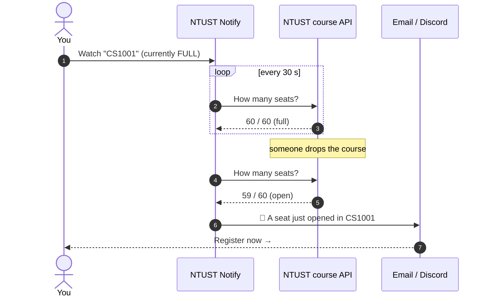

<div align="center">


# NTUST Notify

**Stop refreshing the course page. Let it tell you when a seat opens.**

Watch any full NTUST course and get an email or Discord ping the moment a seat frees up.<br/>
The server checks for you around the clock, so you don't have to.

[**Open the app →**](https://notify.stanleyowen.com)


</div>

---

## 🎯 Why it exists

Popular NTUST courses fill up in minutes, and seats only come back when someone drops. When that happens, whoever notices first gets the seat. Usually that's whoever happened to hit refresh at the right moment.

NTUST Notify does the refreshing for you. It tells you **once**, the moment a course goes from **FULL → OPEN**, and links you straight to registration.

## ✨ Features

|   |   |
| --- | --- |
| 🔎 **Search** | Find courses by number, name or teacher, with live seat counts |
| 📋 **Watchlist** | Live seats, a per-course alert switch, and a one-tap **Register now** button when a seat opens |
| 🔔 **Alerts** | Email (your Google address) and/or Discord webhook, with a real test send and delivery diagnostics |
| ⏳ **Auto-expiring** | Alerts stay on for 30 days, then switch off to spare the server and NTUST. Extend them with one tap |
| 🌏 **Bilingual** | English and 繁體中文 |
| 🌗 **Themes** | Light and dark, with a mobile-first layout |
| 🗑️ **Your data** | Delete your account and everything in it at any time |

## ⚡ How it works



- **One alert per opening.** You get pinged on the FULL → OPEN transition, not on every check while the course stays open.
- **No false alarms.** If an NTUST request fails, the stale data never changes a course's state.
- **Quiet restarts.** The first check after the server boots only records the current state. It never sends a burst of alerts.
- **Courses with no cap** (NTUST reports `Restrict1 ≥ 9999`) are never treated as full.

---

## 🏗️ Architecture

```text
Browser ──(Google sign-in)──► Firebase Auth
   │
   │  HTTPS + Firebase ID token
   ▼
API server (Express) ──► Firestore (Admin SDK, server-only)
   │      ▲
   │      └── in-memory mirror via onSnapshot (the poll loop never reads Firestore)
   ├──► NTUST course API (shared cache, in-flight de-dupe, keep-alive)
   └──► SMTP / Discord webhooks
```

The browser uses Firebase **only for Google sign-in**. Every read and write goes through the API, which validates it, and `firestore.rules` denies all direct client access.

<details>
<summary><b>🔐 Security model</b></summary>
<br/>

| Concern | How it's handled |
| --- | --- |
| Data access | Firestore is server-only (`allow read, write: if false`). Users can only reach their own data, through authenticated routes. |
| Identity | Every API call verifies a Firebase ID token and requires a verified Google email. Sign-in and account deletion also check revocation (disabled or deleted accounts), and a deleted account's leftover tokens are refused. The alert email and the fast-poll privilege come from the **Auth record**, never from editable document fields. |
| Network | The API listens on `127.0.0.1` by default (`HOST`), so it can only be reached through the local reverse proxy or tunnel, and direct clients can't forge `X-Forwarded-For`. |
| Input | All bodies, params and stored values are validated or normalized in `server/src/validate.js`. Course metadata is fetched from NTUST server-side, never taken from the client. |
| SSRF | Discord webhooks must be `https://discord.com/api/webhooks/{id}/{token}`: strict host and path, no credentials, ports or redirects. |
| Abuse | Per-user rate limits on every authenticated route, a generous per-IP flood limit (friendly to campus NAT), a capped watchlist size and an 8 KB body limit. |
| Mentions | Discord `allowed_mentions` only ever pings the configured user. |
| Errors | A central JSON error handler. No stack traces or upstream error text reach clients. |
| Frontend | A strict CSP generated at build time from your env (`vite.config.js`), plus HSTS, `X-Frame-Options`, `nosniff`, `Referrer-Policy`, `Permissions-Policy` and COOP. |
| Container | Node 24 Alpine, non-root, read-only root filesystem, all capabilities dropped, `no-new-privileges` and a healthcheck. Secrets are mounted read-only and never copied into the image. |

</details>

<details>
<summary><b>🚀 Performance</b></summary>
<br/>

- **One shared NTUST client** serves search, the watchlist and the poller. Search results warm the per-course cache, so watching a course you just found is instant.
- **No duplicate calls.** Concurrent identical requests share a single upstream call. Connections are kept alive, so warm calls skip the TLS handshake.
- **Lean payloads.** NTUST responses are cut down to the fields the app uses and merged per course (NTUST returns one row per time/room block). That roughly halves the payload per course.
- **Poll once per course.** Each distinct `(semester, course)` is fetched once per cycle, at the interval of its fastest subscriber, however many people watch it.
- **Expired alerts cost nothing.** The poller skips them immediately, and a sweep at startup and every 10 minutes persists the switch-off.
- **Batched live seats.** The watchlist's live seats come from one batched request served from cache, refreshed every minute while the tab is visible.
- **Small bundle.** The client ships without the Firestore SDK (about 52% smaller than before), and Firebase sits in its own long-cached chunk.

</details>

<details>
<summary><b>📁 Project structure</b></summary>
<br/>

```text
client/                     React + Vite SPA
  src/
    context/                Auth, Account (data + optimistic mutations), Toasts
    components/             Views (Search, Watchlist, Alerts) and UI pieces
    lib/                    API client, course helpers, routing, theme
    locales/                en, zh-TW
    styles.css              design system (tokens → components)
  vite.config.js            build + generated security headers
server/
  index.js                  process entry: wiring + graceful shutdown
  src/
    config.js               validated env config
    validate.js             all input validation and normalization
    ntust.js                NTUST client (cache, de-dupe, projection, merge)
    store.js                Firestore gateway + real-time mirror
    poller.js               FULL → OPEN detection and alert delivery
    notifier.js             email + Discord senders
    app.js                  Express routes, auth, rate limits, errors
  test/                     node:test suites (no network or Firebase needed)
firestore.rules             deny-all client rules
firebase.json
```

</details>

---

## 🛠️ Run it yourself

> [!NOTE]
> The two workspaces use **different package managers**: npm in `server/`, yarn in `client/`.

**Backend** (Node ≥ 22, npm)

```bash
cd server
cp .env.example .env        # fill in Firebase, SMTP and polling settings
npm ci
npm run dev                 # node --watch
npm test                    # node:test, no network or Firebase needed
```

**Frontend** (Node ≥ 24.12, yarn)

```bash
cd client                   # .nvmrc pins Node 24 (Netlify uses it too)
cp .env.example .env        # VITE_API_URL=http://localhost:3000 for local dev
yarn
yarn dev                    # http://localhost:3001
yarn build                  # also emits dist/_headers (CSP)
```

**Docker** (alternative backend)

```bash
cd server
docker compose up --build -d
```

`docker-compose.yaml` mounts `./service-account.json` read-only at `/run/secrets/` and sets `GOOGLE_APPLICATION_CREDENTIALS` for you. The port is published on `127.0.0.1` by default, so only a reverse proxy on the same host can reach it. Set `BIND_ADDR=0.0.0.0` in `.env` only if clients must connect directly.

<details>
<summary><b>📦 Deploying (order matters)</b></summary>
<br/>

1. **Backend first.** The client depends on the API routes being there.
2. **Frontend.** The Netlify build env needs `VITE_API_URL` and the `VITE_FIREBASE_*` values, because the CSP is generated from them.
3. **Firestore rules.** Deploy them separately to deny all client access:
   ```bash
   npx firebase-tools deploy --only firestore:rules
   ```
   You can also paste `firestore.rules` into Firebase Console → Firestore → Rules.

If the CSP blocks something in your environment, build with `VITE_CSP_REPORT_ONLY=true` to switch it to report-only while you investigate.

</details>

<details>
<summary><b>🔌 API reference</b></summary>
<br/>

All `/api/*` routes except `/api/semesters` need `Authorization: Bearer <Firebase ID token>`. Errors are `{ "error": string, "code": string }`.

| Method | Route | Purpose |
| --- | --- | --- |
| GET | `/health` | Liveness + Firestore mirror state |
| GET | `/api/semesters` | Semester list (cached 1 h) |
| POST | `/api/courses` | Search `{ semester, courseNo \| courseName \| teacher }` |
| POST | `/api/session` | Record sign-in; returns account bootstrap |
| GET | `/api/me` | Account bootstrap (profile, prefs, watchlist, limits) |
| PUT | `/api/me/prefs` | Save alert preferences |
| DELETE | `/api/me` | Delete account and all data |
| GET | `/api/watchlist/live` | Live seats for every watched course |
| PUT | `/api/watchlist/:courseNo` | Watch `{ semester, notifyEnabled? }` |
| PATCH | `/api/watchlist/:courseNo` | `{ notifyEnabled }` |
| DELETE | `/api/watchlist/:courseNo` | Unwatch |
| POST | `/api/notify/test` | Send a test alert (5 per 10 min) |
| GET | `/api/notify/status` | Delivery diagnostics |

</details>

---

<div align="center">

**MIT licensed** · see [LICENSE](LICENSE)

<sub>NTUST Notify is an independent project and is not affiliated with National Taiwan University of Science and Technology.</sub>

</div>
